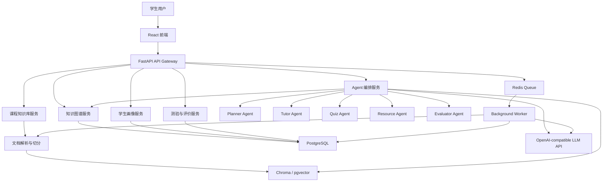

# A3 开源项目技术调研与技术路线建议

调研日期：2026-06-01  
赛题：A3 - 基于大模型的个性化资源生成与学习多智能体系统开发

## 1. 调研结论

综合功能贴合度、实现复杂度、协议风险和比赛周期，建议采用如下策略：

1. 产品形态参考 `OpenMAIC` 和 `studyield`，但不复用代码。两者都贴合 A3，但 `AGPL-3.0` 协议对参赛作品后续闭源、展示和二次开发不够友好。
2. 个性化学习能力重点参考 `adaptive-knowledge-graph`，尤其是 `Knowledge Graph + RAG + Student Model` 的边界设计。
3. 快速原型和 Agent 分工参考 `Multi-Agent-Study-Assistant`，但该仓库没有明确 license，不应复制代码。
4. 工程实现建议不要照搬大型项目，而是自主实现一个可控的中等规模系统：`React/Next.js + FastAPI + PostgreSQL + Chroma + Redis + LangGraph 或自研 Agent Orchestrator`。

推荐的参赛系统方向：

> 面向大学课程学习的个性化资源生成与学习多智能体系统。系统围绕学生画像、课程知识图谱、文档知识库、学习路径规划、资源生成、测验评估和学习反馈形成闭环。

## 2. 项目总览

| 项目 | GitHub | 主要语言 | 协议 | 适合参考内容 | 复用建议 |
|---|---|---:|---|---|---|
| OpenMAIC | https://github.com/THU-MAIC/OpenMAIC | TypeScript | AGPL-3.0 | 多智能体课堂、课件/白板/互动教学体验、LangGraph 编排 | 只参考产品形态和 Agent 工作流 |
| Studyield | https://github.com/studyield/studyield | TypeScript | AGPL-3.0 | AI 学习平台、考试准备、知识图谱、Teach-back、资源与测验生成 | 只参考功能设计和模块边界 |
| Open TutorAI CE | https://github.com/Open-TutorAi/open-tutor-ai-CE | Svelte/Python | BSD-3-Clause | 教育平台、权限、RAG、Ollama/OpenAI 兼容、多模型接入 | 可参考架构，但项目体量偏大 |
| Adaptive Knowledge Graph | https://github.com/MysterionRise/adaptive-knowledge-graph | Python/TypeScript | MIT | KG-aware RAG、Neo4j、OpenSearch、IRT/BKT 学生掌握度建模 | 重点参考个性化和知识图谱设计 |
| Multi-Agent Study Assistant | https://github.com/A-R007/Multi-Agent-Study-Assistant | Python | 未发现明确 license | 6 类学习 Agent、Streamlit 原型、RAG 文档问答 | 只参考 Agent 划分，不复制代码 |
| AI Learning Path Generator | https://github.com/arun3676/ai-learning-path-generator | Python | MIT | 学习路径生成、后台任务、Redis Queue、PostgreSQL、部署拆分 | 参考异步任务和学习路径生成 |

说明：`studyield` 的 README badge 曾显示 Apache-2.0，但仓库根目录 `LICENSE` 实际为 `AGPL-3.0`，应按仓库实际 license 谨慎处理。

## 3. 单项目分析

### 3.1 OpenMAIC

定位：多智能体交互式课堂系统，强调“一键获得沉浸式 multi-agent learning experience”。

技术栈：

- 前端/全栈：`Next.js 16`、`React 19`、`TypeScript`
- Agent 编排：`LangGraph`
- LLM 接入：`@ai-sdk/openai`、`@ai-sdk/anthropic`、`@ai-sdk/google`、`openai`
- UI 与编辑能力：`Radix UI`、`shadcn` 风格组件、`ProseMirror`、`KaTeX`、`ECharts`、`pptxgenjs`
- 测试：`Vitest`、`Playwright`
- 部署：`Dockerfile`、`docker-compose.yml`、Vercel 支持

架构与实现思路：

- 将课堂拆成多个角色和工具，例如教师、助教、课件生成、白板、问答和课堂交互。
- 使用 `LangGraph` 做流程编排，适合处理多 Agent 状态流转。
- 前端能力很重，不只是聊天，而是围绕课堂过程做课件、白板、公式、图表等学习对象的生成与展示。

优点：

- 与 A3 的“多智能体学习系统”高度贴合。
- 产品完成度高，适合参考交互体验和 Agent 工作流。
- 工程质量较强，有测试、e2e、评测脚本和 Docker 部署。

缺点：

- `AGPL-3.0` 协议风险高，不建议复用代码。
- 技术栈较新且重，`Next.js 16 + React 19` 对比赛短周期开发不一定稳。
- 功能面很大，直接模仿容易失控。

可借鉴点：

- Agent 工作流：`Planner -> Content Generator -> Tutor -> Evaluator`。
- 教学内容不只输出文本，还可以生成课件、板书、思维导图、测验。
- 增加白板/学习画布视图，提高演示效果。

不建议借鉴点：

- 不建议照搬其复杂前端编辑器和课堂系统全量能力。
- 不建议复用 AGPL 代码。

### 3.2 Studyield

定位：AI-powered learning platform，覆盖考试准备、个性化学习、multi-agent problem solving、knowledge graphs、teach-back evaluation。

技术栈：

- 前端：`React 19`、`Vite`、`TypeScript`、`Tailwind CSS`、`Radix UI`、`Zustand`、`React Query`
- 后端：`NestJS`、`TypeScript`
- 数据与任务：`PostgreSQL`、`Redis`、`BullMQ`
- 检索与 AI：`Qdrant`、`OpenAI`、`LangChain`
- 实时通信：`Socket.IO`
- 文档处理：`pdf-parse`、`mammoth`、`youtube-transcript`

架构与实现思路：

- 前后端分离，后端按业务模块组织。
- 使用队列处理资源生成、文档处理、长任务。
- 强调从学习资料、考试目标和学生状态出发生成学习资源。
- Teach-back 评价可作为 A3 差异化亮点：让学生用自己的话解释概念，系统评价理解程度。

优点：

- A3 功能覆盖面非常贴近。
- 技术栈工程化，适合大型学习平台。
- `Qdrant + Redis + PostgreSQL + BullMQ` 的组合适合正式系统。

缺点：

- 实际 license 为 `AGPL-3.0`，不建议代码复用。
- 功能面大，短期内全做会导致质量下降。
- `NestJS + React` 对个人或小队伍来说开发量偏大。

可借鉴点：

- 资源生成与测验生成拆成异步任务。
- 学习行为、测验结果、掌握度评估形成闭环。
- Teach-back 评价用于体现“个性化”和“学习科学”。

### 3.3 Open TutorAI CE

定位：开源教育协作平台，支持 OpenAI-compatible API、本地 `Ollama`、权限、用户组、RAG 和多种文档处理。

技术栈：

- 前端：`SvelteKit`、`TypeScript`、`Vite`、`Tailwind CSS`
- 后端：`FastAPI`、`Pydantic`、`SQLAlchemy`、`Alembic`
- 数据库与向量库：`PostgreSQL`、`pgvector`、`ChromaDB`、`Milvus`、`Qdrant`、`OpenSearch`
- LLM：`OpenAI`、`Anthropic`、`Google Generative AI`、`Ollama` 兼容
- 文档解析：`pypdf`、`docx2txt`、`python-pptx`、`unstructured`、`RapidOCR`
- 部署：多个 Docker Compose 配置、Kubernetes 配置

架构与实现思路：

- 大平台式架构，强调可部署、可配置、多模型、多存储后端。
- 权限、用户组和模型供应商配置较完整。
- RAG 能力偏通用教育平台和知识库。

优点：

- `BSD-3-Clause` 协议友好。
- 后端技术栈适合 A3：`FastAPI + PostgreSQL + pgvector/Chroma + LLM API`。
- 支持本地模型和云模型，可用于比赛演示的国产化/低成本叙述。

缺点：

- 体量太大，依赖复杂。
- 前端使用 `SvelteKit`，如果团队不熟悉，学习成本较高。
- 多种向量库和模型后端会增加配置复杂度。

可借鉴点：

- 后端用 `FastAPI`，将模型、知识库、文档解析、用户管理分层。
- 文档解析 pipeline 可支持 PDF、PPT、Word、网页。
- 模型供应商抽象：统一封装 OpenAI-compatible endpoint，便于后续换模型。

### 3.4 Adaptive Knowledge Graph

定位：结合 `Knowledge Graphs`、`Local LLMs`、`Adaptive Learning` 的隐私优先 AI Tutor。

技术栈：

- 后端：`FastAPI`、`Pydantic`、`Poetry`
- 前端：`Next.js 14`、`TypeScript`
- 知识图谱：`Neo4j`、`NetworkX`、`RDFLib`
- 检索：`OpenSearch`、`sentence-transformers`
- LLM：`Ollama`、`OpenRouter-compatible OpenAI API`
- 学生建模：`IRT`、`BKT`、`scikit-learn`、`numpy`、`pandas`
- 评测：`pytest`、`ragas`

架构与实现思路：

- 前端提供知识图谱、Quiz、Learning Path 和 Chat 四个主要视图。
- 后端提供 `/api/v1/ask`、`/api/v1/quiz/generate`、`/api/v1/graph/data`、`/api/v1/learning-path/{concept}` 等 API。
- 业务层将 RAG Retriever、NLP/LLM Client、KG Adapter、Student Model、Quiz Generator 分离。
- 数据层将 `Neo4j` 存概念关系，`OpenSearch` 存 chunk 和向量，本地/远程 LLM 负责生成。

优点：

- 与 A3 的“个性化”高度匹配，比普通聊天助手更有技术深度。
- `MIT` 协议友好。
- 模块边界清晰，适合改造成参赛系统蓝本。
- `BKT/IRT` 能体现学习效果评估，不只是生成内容。

缺点：

- `Neo4j + OpenSearch + Ollama` 对新手部署稍重。
- 如果比赛周期短，完整知识图谱构建可能超出能力。
- 项目 star 少，需要自行判断成熟度。

可借鉴点：

- 用课程知识点和先修关系构建课程知识图谱。
- 将 RAG 从“语义相似”升级为“概念相关”：先定位知识点，再扩展先修/后继/相关概念。
- 用测验结果更新学生掌握度，驱动学习路径和资源推荐。

### 3.5 Multi-Agent Study Assistant

定位：基于 Streamlit 的多 Agent 学习助手，提供学生分析、学习路径、测验、导师、RAG 文档问答和资源推荐。

技术栈：

- UI：`Streamlit`
- Agent：`phidata`
- RAG：`LangChain`、`ChromaDB`
- LLM：`OpenAI`、`Groq`
- 搜索：`DuckDuckGo Search`
- 配置：`.env`、`prompts.yaml`

架构与实现思路：

- `app.py` 负责 Streamlit UI。
- `agent_handler.py` 负责编排工作流和状态。
- `study_agents.py` 定义 Agent 角色和 persona。
- `rag_helper.py` 提供文档问答能力。
- `prompts.yaml` 集中管理提示词。

Agent 角色：

- `Student Analyzer Agent`：分析学生基础、目标和学习风格。
- `Roadmap Creator Agent`：生成学习路径。
- `Quiz Generator Agent`：生成题目和解释。
- `Tutor Agent`：个性化讲解。
- `Resource Finder Agent`：查找资源。
- `RAG Tutor Agent`：基于上传资料问答。

优点：

- 架构简单，适合理解 Multi-Agent 的最小实现。
- Agent 分工非常贴合 A3。
- 适合用作早期原型参考。

缺点：

- 未发现明确 license，不应复制代码。
- `Streamlit` 更适合 Demo，不适合作为最终工程化作品。
- 状态、权限、数据持久化、学习记录等能力较弱。

可借鉴点：

- Agent 角色划分和提示词集中管理。
- 初期原型可以先用类似结构验证业务流程，再迁移到正式前后端架构。

### 3.6 AI Learning Path Generator

定位：AI 个性化学习路径生成系统，采用 React 前端、Flask API、Redis Queue、PostgreSQL 和 OpenAI/Perplexity。

技术栈：

- 前端：`React`、`Vite`、`Tailwind CSS`
- 后端：`Flask`、`Flask-SQLAlchemy`、`Flask-Login`、`Flask-Migrate`
- 异步任务：`Redis`、`RQ`
- 数据库：`PostgreSQL`
- RAG/Embedding：`LangChain`、`ChromaDB`、`FAISS`、`sentence-transformers`
- 观测：`LangSmith`、`wandb`
- 部署：Vercel 前端 + Render API/Worker

架构与实现思路：

- 前端发起学习路径生成请求。
- 后端返回 task id。
- Redis Queue 调度后台 worker 执行长耗时生成。
- 生成结果写入 PostgreSQL。
- 前端轮询状态并展示结果。

优点：

- `MIT` 协议友好。
- 异步任务架构适合资源生成、测验生成、知识库构建等长任务。
- 学习路径生成是 A3 的核心功能之一。

缺点：

- 使用较老的 `LangChain 0.0.267` 和 `Pydantic v1`，不建议照搬依赖版本。
- 仓库文档和临时修复文件很多，工程整洁度一般。
- `Flask` 可用，但如果后续做 API 类型系统和异步任务，`FastAPI` 更适合。

可借鉴点：

- 长任务不要阻塞请求，应采用 `任务表 + 队列 + worker + 状态查询`。
- 学习路径结果应持久化，支持继续学习、修改路径和进度追踪。

## 4. 横向比较

### 4.1 技术栈比较

| 维度 | 轻量原型 | 工程化推荐 | 高复杂度方案 |
|---|---|---|---|
| 前端 | Streamlit | React/Next.js + TypeScript | OpenMAIC 式复杂编辑器 |
| 后端 | Flask | FastAPI | NestJS 微服务化 |
| Agent | 手写编排 / phidata | LangGraph 或自研 Orchestrator | 多层 LangGraph + MCP |
| RAG | Chroma | Chroma/pgvector + rerank | Qdrant/OpenSearch + GraphRAG |
| 个性化 | prompt 中携带画像 | 学生画像表 + 掌握度模型 | IRT/BKT + KG-aware RAG |
| 长任务 | 同步请求 | Redis + RQ/Celery | BullMQ / 分布式队列 |
| 部署 | 本地运行 | Docker Compose | Kubernetes / 云原生 |

比赛建议选择“工程化推荐”列，避免轻量原型显得简单，也避免高复杂度方案导致无法按期完成。

### 4.2 架构边界比较

推荐将系统拆成以下边界：

| 模块 | 职责 | 参考项目 |
|---|---|---|
| 用户与学生画像模块 | 保存学习目标、基础水平、学习风格、时间约束 | Studyield、Multi-Agent Study Assistant |
| 课程知识库模块 | 上传资料、解析文档、切分、embedding、向量检索 | Open TutorAI、Studyield |
| 知识图谱模块 | 管理知识点、先修关系、课程章节、难度 | Adaptive Knowledge Graph |
| Agent 编排模块 | 组织 Planner、Tutor、Quiz、Resource、Evaluator 协作 | OpenMAIC、Multi-Agent Study Assistant |
| 学习路径模块 | 根据画像和知识图谱生成阶段化路线 | Adaptive Knowledge Graph、AI Learning Path Generator |
| 资源生成模块 | 生成讲义、例题、总结、练习、思维导图 | OpenMAIC、Studyield |
| 测验与评价模块 | 生成测验、判题、解释、更新掌握度 | Adaptive Knowledge Graph、Studyield |
| 异步任务模块 | 处理文档解析、向量化、资源生成等耗时任务 | Studyield、AI Learning Path Generator |

### 4.3 协议风险比较

| 项目 | 协议 | 风险 |
|---|---|---|
| OpenMAIC | AGPL-3.0 | 高，网络服务分发和修改代码义务较强 |
| Studyield | AGPL-3.0 | 高，应只参考思路 |
| Open TutorAI CE | BSD-3-Clause | 低，但仍需保留版权声明 |
| Adaptive Knowledge Graph | MIT | 低，但注意第三方教材内容 attribution |
| Multi-Agent Study Assistant | 未发现明确 license | 高，默认不要复制代码 |
| AI Learning Path Generator | MIT | 低 |

## 5. 建议的 A3 参赛技术路线

### 5.1 技术选型

推荐：

- 前端：`React + Vite + TypeScript + Tailwind CSS`
- 后端：`FastAPI + Pydantic + SQLAlchemy`
- 数据库：`PostgreSQL`
- 向量库：第一阶段用 `Chroma`，后续可切换 `pgvector`
- 缓存与任务：`Redis + RQ` 或 `Celery`
- Agent 编排：第一阶段自研轻量 `AgentOrchestrator`，第二阶段再接 `LangGraph`
- LLM 接入：统一封装 OpenAI-compatible API，支持 `DeepSeek`、`Qwen`、`OpenAI` 或本地 `Ollama`
- 文档解析：`pypdf`、`python-docx`、`unstructured` 可选
- 可视化：知识图谱用 `React Flow` 或 `Cytoscape.js`

不建议：

- 一开始上 `Neo4j + OpenSearch + Kubernetes`，部署成本太高。
- 直接用 `Streamlit` 做最终作品，工程感和扩展性不足。
- 使用 `AGPL-3.0` 项目代码进入核心仓库。

### 5.2 推荐系统架构

### 5.3 Agent 边界设计

| Agent | 输入 | 输出 | 说明 |
|---|---|---|---|
| `Profile Agent` | 学生目标、基础、学习时间、历史测验 | 学生画像、知识缺口 | 建议不要只靠 prompt，应落库 |
| `Planner Agent` | 学生画像、知识图谱、课程目标 | 阶段化学习路径 | 体现个性化 |
| `Resource Agent` | 学习路径节点、知识库检索结果 | 讲义、例题、阅读材料 | 结合 RAG，避免幻觉 |
| `Tutor Agent` | 学生问题、资料上下文、知识点状态 | 个性化解释 | 支持不同学习风格 |
| `Quiz Agent` | 知识点、难度、掌握度 | 测验题、答案、解析 | 与评价闭环结合 |
| `Evaluator Agent` | 学生答案、标准解析、历史表现 | 掌握度更新、补救建议 | 可引入 BKT/IRT 简化版 |

### 5.4 数据边界设计

核心表建议：

- `users`：用户基础信息
- `student_profiles`：学习目标、基础、偏好、时间约束
- `courses`：课程
- `concepts`：知识点
- `concept_relations`：先修、相关、包含关系
- `documents`：上传资料
- `document_chunks`：切分片段和向量索引引用
- `learning_paths`：学习路径
- `learning_path_items`：阶段、知识点、资源、状态
- `generated_resources`：生成的讲义、例题、总结
- `quizzes` / `quiz_items`：测验和题目
- `attempts`：作答记录
- `mastery_records`：知识点掌握度记录
- `agent_runs`：Agent 调用日志，用于演示可解释性

### 5.5 最小可行版本

第一阶段应保证能演示完整闭环：

1. 上传课程资料。
2. 系统解析并建立课程知识库。
3. 学生填写学习目标和基础水平。
4. Planner Agent 生成学习路径。
5. Resource Agent 生成某个知识点的讲义和例题。
6. Tutor Agent 基于资料回答问题并给出引用。
7. Quiz Agent 生成小测。
8. Evaluator Agent 根据答案更新掌握度并调整后续路径。

第二阶段再增强：

- 知识图谱可视化。
- Teach-back 评价。
- 错题本和复习计划。
- 多模型切换。
- 演示用课程模板。

## 6. 最终建议

本项目应避免做成“AI 聊天 + 上传 PDF”的普通知识库。A3 的竞争点应放在：

1. `Multi-Agent` 有明确分工和可解释执行记录。
2. `Personalization` 不只是 prompt，而是有学生画像、掌握度和学习路径调整。
3. `Resource Generation` 不只是生成文本，还包括讲义、例题、测验、复习计划。
4. `Knowledge Grounding` 通过 RAG 和知识图谱降低幻觉。
5. `Engineering Completeness` 有前后端分离、数据库、任务队列、日志、文档和部署脚本。

推荐最终命名方向：

- 智学引擎：面向大学课程的个性化多智能体学习系统
- CourseMind：基于知识图谱与多智能体协作的个性化学习平台
- LearnPilot：面向课程学习的 AI 原生资源生成与学习路径规划系统

