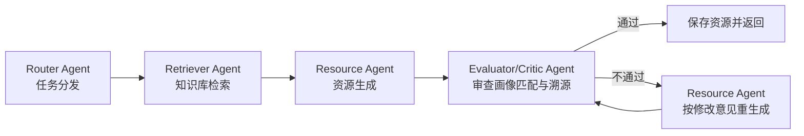
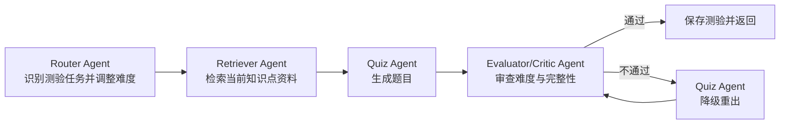

# 多智能体边界与协同闭环说明

本文档用于答辩时说明本系统不是“单模型长提示词”，而是具备角色边界、协同流转和工具隔离的多智能体工程原型。

## 1. Agent 职责边界

| Agent | 单一职责 | 不允许做的事 |
|---|---|---|
| Router Agent | 识别任务意图，输出结构化分发决策 | 不生成学习内容，不访问知识库，不写数据库 |
| Retriever Agent | 调用知识库检索，返回 chunk 与 source refs | 不改写学生画像，不生成最终资源 |
| Profile Updater Agent | 根据学习轨迹更新学生画像 | 不生成题目或讲义 |
| Resource Agent | 基于 Router 任务和 Retriever 证据生成学习资源 | 不直接读取原始数据库，不自行检索资料 |
| Quiz Agent | 生成测验题、答案和解析 | 不评价学生作答 |
| Tutor Agent | 基于检索证据进行答疑 | 不修改画像，不绕过 citation 校验 |
| Evaluator/Critic Agent | 评分、审查生成内容、提出修订意见 | 不负责生成最终资源正文 |

## 2. 工具权限表

| Agent | 可用工具 |
|---|---|
| Router Agent | `intent_classification`, `task_dispatch_json` |
| Retriever Agent | `knowledge_search`, `source_ref_extraction` |
| Profile Updater Agent | `profile_read`, `profile_write`, `agent_trace_read` |
| Resource Agent | `resource_generation`, `markdown_formatting` |
| Quiz Agent | `quiz_generation`, `difficulty_control` |
| Tutor Agent | `grounded_answering`, `citation_validation` |
| Evaluator/Critic Agent | `rubric_scoring`, `critic_review`, `mastery_update` |

代码中的权限声明位于：

- `src/backend/app/agents/router_agent.py`

## 3. 当前已实现的协同流

### 资源生成

实现位置：

- `src/backend/app/services/resource_service.py`

### 测验生成

实现位置：

- `src/backend/app/services/assessment_service.py`

## 4. 前端可解释性呈现

前端不再使用全局执行追踪浮层，而是在画像、路径、资源、测验等核心按钮下方显示内联式协同终端。

终端展示来自 `AgentRun` 和 `AgentRunStep` 的真实后端日志，包括：

- 执行动作的 Agent 名称
- 输入摘要
- 输出摘要
- 决策依据
- 是否发生 Critic 打回与重生成

实现位置：

- `src/frontend/src/App.tsx`
- `src/frontend/src/styles.css`

## 5. 答辩表述建议

推荐表述：

> 系统采用轻量级多智能体编排。Router Agent 只负责结构化分发，Retriever Agent 独占知识库检索工具，Resource/Quiz Agent 只负责生成，Evaluator/Critic Agent 负责审查与纠错。所有协同过程都会写入 AgentRun/AgentRunStep，并在前端业务按钮下方以协同终端方式展示。

不建议表述：

> 所有功能都由一个学习管家 Agent 完成。

因为这会削弱多智能体边界感。
